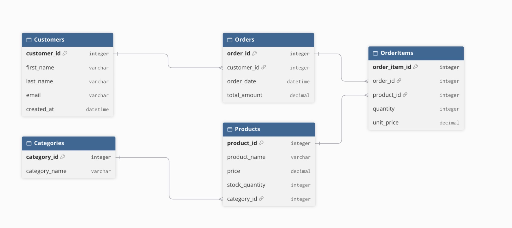

# E-Commerce Database System

A relational database project for an e-commerce platform built with SQLite.

## Overview
This database model manages core e-commerce workflows: customer profiles, category indexing, product inventory, order processing, and line-item order details.

## Database Schema Structure
The schema includes 5 main entities:
- **Customers**: Stores customer details and account creation timestamp.
- **Categories**: Organizes items into product categories.
- **Products**: Tracks pricing, inventory stock, and associated categories.
- **Orders**: Records transactional data per customer.
- **OrderItems**: A junction table linking products and orders to handle many-to-many relationships.

## Entity Relationship Diagram (ERD)

## Analytical Queries Included
- **Customer Lifetime Spending**: Aggregates total spending and order counts per customer.
- **Low Stock Inventory Alert**: Identifies products with inventory under 10 units to trigger restocking.

## How to Run
1. Open any SQL environment (e.g., SQLite, sqliteonline.com).
2. Import or copy the code from `schema.sql`.
3. Execute the script to build tables, insert sample records, and view analytical query results.
